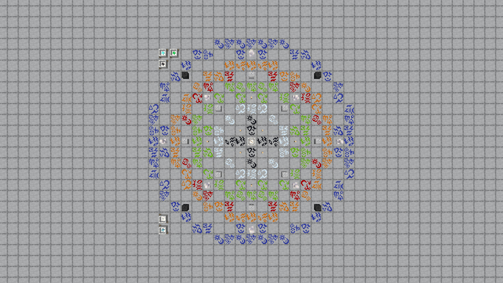
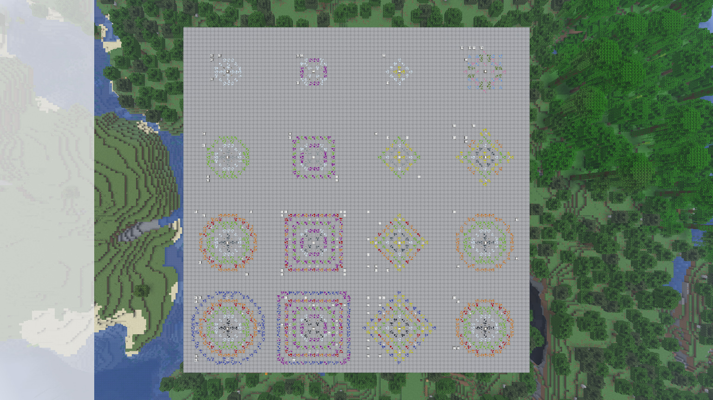
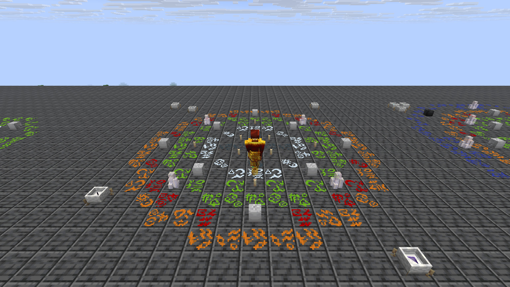
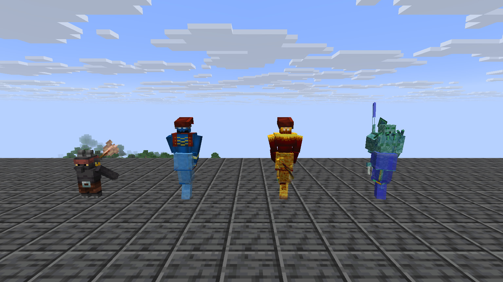
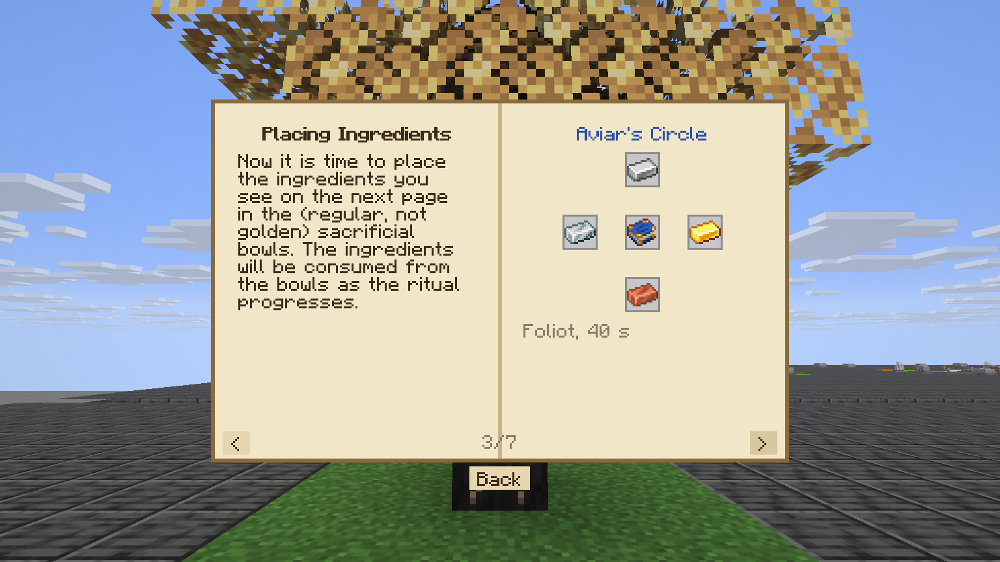
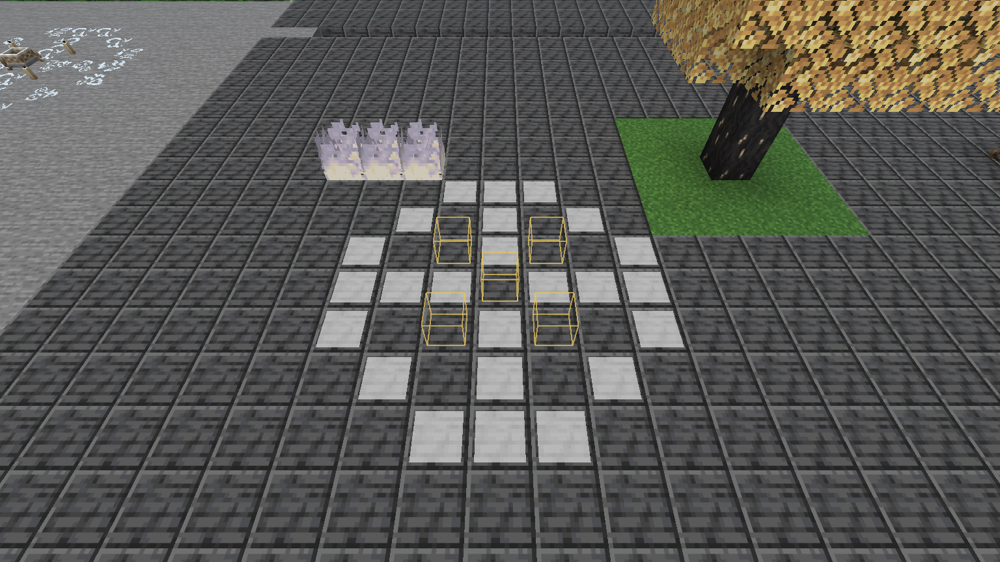
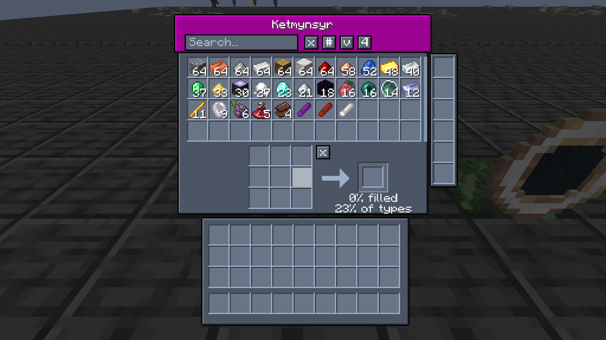
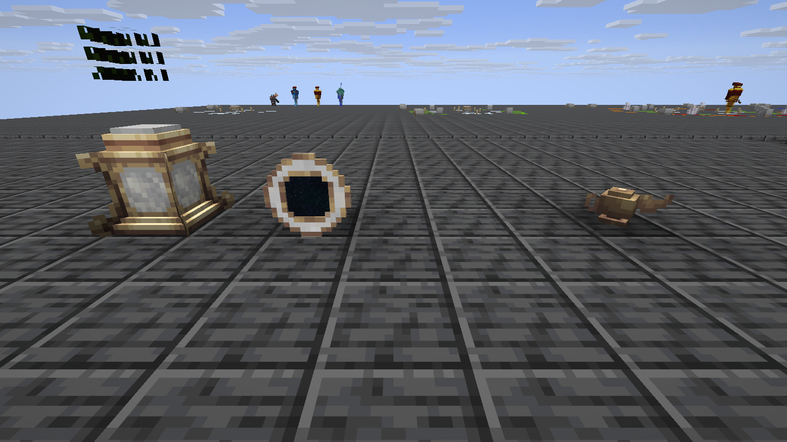

# Occultism

An unofficial port to [Horizon](https://playhorizon.dev) of [Occultism](https://github.com/klikli-dev/occultism),
the mod by KliKli ([klikli-dev](https://github.com/klikli-dev)), made with their permission. Please report problems with
the port here, not to KliKli.

Occultism's working spirits walk around as in Occultism, summoned in its own **ritual circles**:
chalk glyphs drawn around a golden sacrificial bowl, ingredients on sacrificial bowls, a binding book
to start the ritual. The crushers (a foliot, djinni, afrit or marid, each at its rank) pick up ores
and other crushables lying near them, crush them in their hands and drop the dust at their feet.
The working foliots come bound to a book of calling: the janitor gathers dropped items, the
transporter moves stacks between containers, the lumberjack fells and replants trees and the farmer
harvests and replants crops, each bringing what it gathers to a container. Soul gems capture
creatures whole.

- **Same numbers as Occultism.** Recipes are Occultism's own `occultism:crushing` files; ranks use
  its config defaults (Foliot 400 ticks x2, Djinni 200 x3, Afrit 100 x4, Marid 61 x6 on raw iron),
  tier gates (`min_tier`/`max_tier`) and the ingot rule (`ignore_crushing_multiplier`).
  The timings were cross-checked against Java's float math.
- **Rituals as in Occultism.** Its pentacles (`summon_foliot` to `summon_marid`, `craft_foliot`),
  checked in all four rotations; its ritual recipes, durations and ingredient timing (one every
  duration / (ingredients + 1) seconds from bowls within 8 blocks); an interrupted ritual keeps its
  book in the bowl. The result lands in the golden bowl.
- **Iesnium without the hidden ore.** There is no iesnium ore to vein-mine by mistake: a player
  with the Third Eye finds raw iesnium in 20% of the silver ore they mine, 40% wearing Otherworld
  Goggles (`ritual.rs`), vein mining included. Deep miner spirits dig raw iesnium too, as rarely as
  Occultism's dig its ore.
- **More of Occultism's magic.** Weather and time magic, the trader spirits, the wild hordes,
  the Wild Hunt and the trial breezes, possessions and resurrections, flaming paste, silver and
  infused tools and armour, the butcher knives, and the iesnium bowls that run a ritual four times
  as fast. The [changelog](CHANGELOG.md) lists what each release adds and where the port still
  differs from Occultism.

## Screenshots

| | |
|---|---|
|  |  |
| Fatma's Incentivized Attraction, the marid summoning circle, in every chalk | All 16 pentacles, one row per rank: foliot, djinni, afrit, marid |
|  |  |
| An afrit summoned in its circle | The spirits |
|  |  |
| A ritual page in the Dictionary of Spirits | A circle preview (the satchels don't build it yet) |
|  |  |
| The storage terminal | A storage Actuator, a stable wormhole and a dimensional mineshaft |

## Install (alpha)

0.13.1-alpha.1 is a work-in-progress alpha: expect rough edges and keep backups of your worlds.

It is one file, `occultism_horizon-0.13.1-alpha.1.hmod`: the native code and the content (blocks,
items, recipes, textures) together, on Horizon's mod API. It is built for Horizon Nightly 2026-11-21
(`8f83e5c`) and its signed mod SDK, with launcher 0.2.78 or newer.

- **From the launcher's registry:** the port is listed as **Occultism**, id `occultism_horizon`
  (the registry's `occultism` is a separate port by AdLf0208; the two can't be turned on together).
- **From this repository:**
  `horizon-launcher mods add-github https://github.com/Dawnforger/occultism-horizon/releases/tag/v0.13.1-alpha.1 --trust-native-code`,
  or download `occultism_horizon-0.13.1-alpha.1.hmod` from that release and install it from the
  launcher's Mods page (Install from file). Build the instance. GitHub installs aren't reviewed by
  the Horizon registry.

Worlds from versions before 0.11.1-alpha.2, whose id was `occultism`, ask once about the missing
`occultism` mod as they open: open them (with a backup if you like) and everything is there, since
the blocks and items keep the `occultism` namespace. Remove the old `occultism` file from the
instance first.

The launcher asks you to trust the native code before it builds it: it runs with your account's
permissions. `./build.sh` in the source builds the same from an Occultism checkout, with the logic
tests.

### Sunrise

The port also builds for [Sunrise](https://github.com/sunrise-org/sunrise), a fork of Horizon with its
own mod API, launcher and registry. Both come from the same source: `mod/` is the Horizon package,
and `python3 tools/make_sunrise.py` writes `mod-sunrise/`, the Sunrise one, from it (its manifest
`sunrise-mod.toml`, the `sunrise-mod-api` crate, `data/occultism/sunrise/` for content declarations
and Sunrise's attribute names). Where the two APIs differ, the shared code calls `src/platform/`:
`mod/src/platform/horizon.rs` for Horizon, and `sunrise/platform.rs` (kept outside `mod/`, so the Horizon
package doesn't carry it) for Sunrise, with the same names in both; hooks only
Horizon has sit between `// #horizon-begin` and `// #horizon-end`, which the script leaves out.
Then `cd mod-sunrise && cargo sunrise-mod build` packs `occultism.smod`, pinned to Sunrise Nightly
2026-11-20 (`9425651`).

Sunrise's registry lists a native mod for a Nightly by its source: the `sunrise` branch, which holds
`mod-sunrise/` as generated, and which players' launchers build. At each release,
`python3 tools/sunrise_branch.py` commits the new crate to it (in `.work/sunrise-branch`), to push with
the release.

## Layout

| Path | What |
|---|---|
| `mod/` | The mod, one flat package: `horizon-mod.toml`, `Cargo.toml`, `src/` (the native code, a trait mod with Parts) and the generated `assets/` and `data/` |
| `mod/src/logic.rs` | The crushers' rules, no Horizon types |
| `mod/src/lib.rs` | Registration and the global hooks: Parts, containers, the store's payload, ticks, deaths, spirits, loot, commands |
| `mod/src/crushing.rs` | Occultism's crushing recipes, read for the crushers; the recipe readers the rituals share |
| `mod/src/ritual.rs` | The rituals' rules, no Horizon types: pentacles, ingredients, timing, sacrifices, item uses, glyphs, iesnium |
| `mod/src/rites.rs` | Glue for chalk glyphs, sacrificial bowls, the golden bowl's rituals, spirit names, summoning, iesnium |
| `mod/src/soul_gem.rs` | Soul gems: a creature captured whole as its entity data, and let out where the gem is used |
| `mod/src/platform/horizon.rs`, `sunrise/platform.rs` | What Horizon's and Sunrise's mod APIs ask differently, the same names in each |
| `tools/make_sunrise.py` | Writes `mod-sunrise/`, the Sunrise package, from `mod/` |
| `tools/sunrise_branch.py` | Commits `mod-sunrise/` to the `sunrise` branch, the source Sunrise's Nightly list builds |
| `mod/src/workers.rs` | Working spirits: the foliot, djinni, afrit and marid, their job, base, work area and deposit (their Part state), Occultism's crusher, janitor, transporter, lumberjack and farmer goals, and the books of calling |
| `mod/src/spirits.rs` | The unbound afrit and marid: their helpers, immunities and sun-proofing |
| `mod/src/spirit_model.rs` | The unbound spirits and the foliots (in their jobs' looks) drawn from Occultism's GeckoLib models and animations (`spirit_geo.rs`, generated) |
| `mod/src/storage.rs` | The storage's rules, no Horizon types: the store, its save log, capacity |
| `mod/src/network.rs` | A store as a lasting network, no Horizon types: its record and upgrades, what placing an Actuator does, spirit names, the glyphs' orbits |
| `mod/src/terminal.rs` | The storage terminal's rules, no Horizon types: its messages, the client's searched and sorted copy of a store |
| `mod/src/terminal_ui.rs` | The terminal's screen on the client, laid out and coloured as Occultism's: top bar, search, sort and rows, item area, crafting grid, tooltips |
| `mod/src/fire.rs` | Spirit fire and Demon's Dream, no Horizon types: seed drops, where it lights, what it turns items into |
| `mod/src/spirit_fire.rs` | Glue for spirit fire and the datura crop: lighting by dropped fruit, items in the fire, planting |
| `mod/src/mining.rs` | The dimensional mineshaft's rules, no Horizon types: timing, weighted rolls, batching, wear |
| `mod/src/mineshaft.rs` | Glue for the mineshaft: miner recipes resolved by the game, outputs, the container below, its screen |
| `mod/src/vault.rs` | Glue for the storage multiblock, and the one place that turns stacks into keys |
| `mod/src/game.rs` | What the glue asks of the game: items and blocks by id, this mod's components, moves in transactions |
| `docs/storage-design.md` | Why Occultism's storage lags, the performance rules, the structure, the Acolyte roadmap |
| `tests/logic/` | 69 unit tests of the rules, including scale tests, runnable anywhere (`cargo test`) |
| `tools/build_content.py` | Generates `mod/assets`, `mod/data`, `mod/horizon-mod.toml` and `mod/src/spirit_geo.rs` from an Occultism checkout: chalks and glyphs, bowls, silver and iesnium, rituals and pentacles, recipes, tags, Occultism's art |
| `build.sh` | Logic tests, content, `.hmod` pack and check, native build, in that order |
| `TESTING.md` | The in-game passes |
| `CHANGELOG.md`, `VERSION` | What changed in each version; the current version (`tools/set_version.py` writes it everywhere) |

## Status

| Part | State |
|---|---|
| Rules (`logic.rs`, `ritual.rs`, `storage.rs`, `network.rs`, `terminal.rs`, `mining.rs`, `fire.rs`) | 69/69 tests pass; tier timings match a Java oracle |
| Content mod | Generated and self-checked; `cargo horizon-mod check` runs in `build.sh` |
| Glue (`lib.rs`, `rites.rs` and the rest) | 0.11.0-alpha.1 made for Horizon Nightly 2026-11-18 (`0b14f8a`), built and played on 2026-11-20 (`0a875da`) with launcher 0.2.78, and on Sunrise Nightly 2026-11-20 (`9425651`); 0.6.0-alpha.1 on Nightly 2026-11-13 (`9f42064`) |
| In-game (0.7.0) | Full pass of `TESTING.md` on Nightly 2026-11-18 (`0b14f8a`), launcher 0.2.78: every row checked passes (results at its end), after the fixes in `CHANGELOG.md`; not covered: the four two-player rows, hover tooltips, the large-store tick timing, the animations' sway |
| In-game (0.4.0) | Smoke test on Nightly 2026-11-13 (`9f42064`), launcher 0.2.63: the altar crushing raw iron with a Foliot core; a white chalk drawing two glyphs for 2 durability; spirit fire lit over dropped fruit (used up) turning 3 andesite to otherstone; an Actuator placed by hand anchoring a new, named store and opening its terminal; the Eldritch miner digging ores and wearing its lamp |
| In-game (storage) | 0.3.0-alpha.1 on Nightly 2026-11-04: the Actuator, its terminal, upgrades and projection, portable stores and recall, the mineshaft and miners, wormholes (linking, sneak-placing, a mineshaft feeding one) and the Accessor, from `TESTING.md` rows 27 to 56; not yet the miner rituals, the redstone stop, hoppers into a store, or two-player trust |
| In-game (spirit fire) | Unreleased, on Nightly 2026-11-04: spirit fire lit by dropped fruit (all used up); andesite, a diamond, 5 books and feathers turned, stone left alone; planting, bone meal and a ripe harvest; a seed from grass broken by hand; a bound book crafted with the Dictionary kept; otherworld logs from oaks with the Third Eye (3 of 15) and none without, ashes, two impure chalks purified into two chalks, otherstone smelted to burnt otherstone; durable chalk: a glyph per use for one durability, into grass, none in creative, its own colour's glyph turned for free, broken after its last use (`TESTING.md` rows 16, 17 and 57 to 67; the 2% rate is unit-tested, not counted in game) |
| In-game | 0.2.0, agent-driven on Horizon `0f0fa62`: the altar's 15 rows; the Foliot crusher ritual end to end (circle, bowls, timing, result, interrupt, messages); glyph signs, facing, cycling and drops; iesnium rates (19.9% with the Third Eye, 41% with goggles, none without); silver ore generation; the Djinni, Afrit, Marid and infused lenses rituals run side by side, each finishing on time with its result. Rechecked on Nightly 2026-11-04: content load, altar, Foliot ritual, chalk, bowls, iesnium (18% of 60 ores with the Third Eye) |

Not in this port yet: the otherworld's own trees and the rest of its materials (otherworld logs
come from oaks chopped with the Third Eye; chalk colours other than white, yellow and cyan are
dyed from white chalk: see `CHANGELOG.md`), spirit fire's
sound and colours, the spirit's name on a bound book, other spirit jobs, rituals that summon
an entity or ask for an item to be used, sounds and particles, JEI-style recipe display.

A chalk draws 256 glyphs, as Occultism's. Horizon's native API can't place a block by name from a
player's hook, so the glyph appears at the end of the tick it is drawn in. Occultism's code is MIT; its third-party asset notices ship in `mod/`.

## License

MIT, like Occultism: see [LICENSE](LICENSE). [NOTICE](NOTICE) carries Occultism's own MIT notice
(this port is based on its code, data and art, with the blessing of Occultism's creator, KliKli ([klikli-dev](https://github.com/klikli-dev))). Some of Occultism's art is
under Creative Commons Attribution 3.0; its credits ship with the content mod
(`mod/NOTICE-occultism-third-party.txt`, `mod/assets/occultism/textures/about_isabella.txt`), and the
package carries both, Occultism's licence and this NOTICE.
